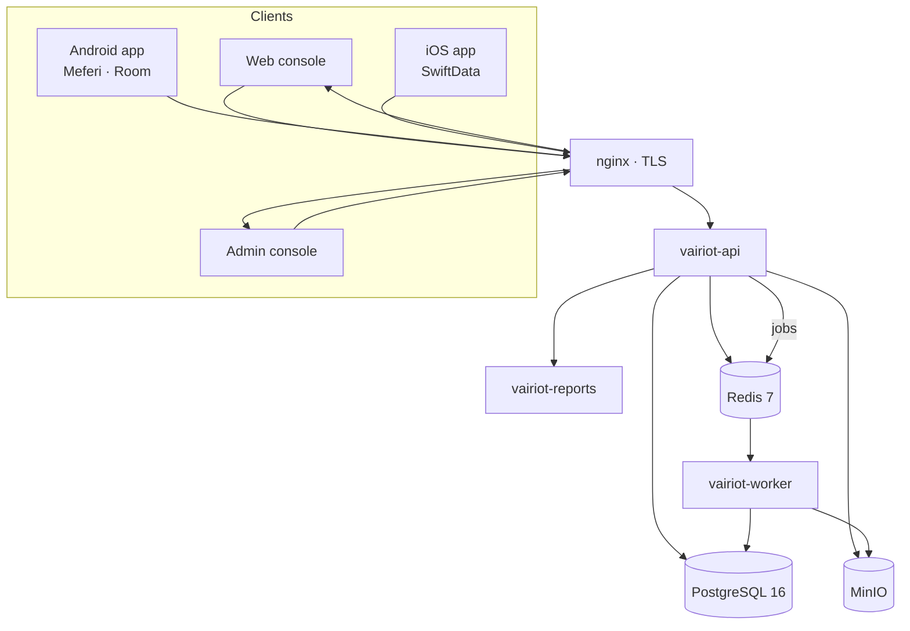

# Phase 0 — Discovery and Architecture

| Item                | Detail                                                                                                                                                                                                                                                          |
| ------------------- | --------------------------------------------------------------------------------------------------------------------------------------------------------------------------------------------------------------------------------------------------------------- |
| Product             | Vairiot Asset Intelligence (`Vairiot-dev`)                                                                                                                                                                                                                      |
| Phase               | 0 — Hardening and hosting (Sprint S0, decision D1); this document is part of stage 0.9                                                                                                                                                                          |
| Status              | Draft — describes the product **as built** at release #84 (`9f0f8ee`) plus the stage 0.9 changes                                                                                                                                                       |
| Revision            | 0.1 (16 October 2026)                                                                                                                                                                                                                                           |
| Date                | 16 October 2026                                                                                                                                                                                                                                                 |
| Client programme    | TUDA — Tbilisi Transport and Urban Development Agency, sprints S0–S5 (`docs/sprints/`)                                                                                                                                                                          |
| Companion documents | [01 Technology stack](01-technology-stack.md) · [02 Data model and module registry](02-data-model-and-module-registry.md) · [Test plan](testing/test-plan.md) · [Adoption audit and plan](standard-adoption-plan.md) · [Stage log](stage-log.md) · `project.md` |

---

## 1. Summary

Vairiot Asset Intelligence is an RFID and IoT fixed-asset management platform. It is in production at `vai.vairiot.com`, with Android (Meferi scanners) and iOS field apps at 1.10.1. It was not built to the Managed Development Standard. This document records what exists, so that later phases are planned against facts rather than memory.

The platform was **designed for multi-tenant SaaS from the start** and is sound in its core: tenants, roles, licences, an audit trail, offline field capture and a separate report renderer. The weaknesses are in **controls that depend on people remembering**: tenant isolation is a hand-written filter, two-factor is optional for everyone, containers run as root, and most rules are not checked by machines.

Sprint S0 (Phase 0) closed the data-loss and recovery risks found in the July 2026 audit. The adoption audit (stage 0.8) found the remaining gaps G1–G20 and the owner decided D1–D9 on 16 October 2026. **Decisions are recorded in `project.md` §8 (D1–D9)**; this document refers to them but does not repeat their full text.

## 2. Sources

| Source                                                         | Date            | What it contributed                                                                         |
| -------------------------------------------------------------- | --------------- | ------------------------------------------------------------------------------------------- |
| `docs/AUDIT-2026-07-19.md`                                     | 19 July 2026    | Full-stack audit at `05c05f9`: security, SaaS, offline, communications, storage, hosting    |
| `docs/sprints/S0-audit-triage.md`                              | 5–6 Oct 2026    | Status of every audit finding at `16df41e`, updated at sprint close with the closing commit |
| `docs/sprints/S0-summary.md`                                   | 6 October 2026  | What Sprint S0 built (stages 0.1–0.7), how to verify it, what remains open                  |
| `Vairiot CI/docs/03-reuse-audit.md` (read-only)                | 12 October 2026 | File-by-file review of this product when it was used as the source for Vairiot CI           |
| `docs/standard-adoption-plan.md`                               | 16 October 2026 | Adoption audit against the standard §17 (G1–G20) and decisions D1–D9                        |
| Code: `vairiot-*/`, `infra/`, `.github/workflows/`, `scripts/` | 16 October 2026 | Versions, layout, schema, flags, tests                                                      |

## 3. Findings

### 3.1 Strengths

| Capability                                                    | Where it lives                                                                  |
| ------------------------------------------------------------- | ------------------------------------------------------------------------------- |
| Multi-tenancy with sub-tenants and tenant switching           | `Tenant.parentTenantId`; `sub-tenants`, `tenant-context` routers                |
| Sign-in with refresh rotation, reuse detection and blacklist  | `auth.service.ts`, `lib/jwt.ts`, `lib/redis.ts`                                 |
| TOTP two-factor, encrypted secret, hashed backup codes        | `two-factor.service.ts`, `lib/crypto.ts` (AES-256-GCM)                          |
| Password policy and progressive lockout held in the database  | `password-policy.service.ts`, `login-protection.service.ts`                     |
| `resource:action` permissions with per-user overrides         | `vairiot-shared` constants, `middleware/authorise.ts`, `UserPermissionOverride` |
| Licence tiers, device slots, asset caps, grace periods        | `Licence`, `LicenceTier`, `DeviceSlot`, `require-active-licence.ts`             |
| Hash-chained, append-only event ledger per asset              | `AssetEvent` (trigger maintains `seq`, `prevHash`, `hash`)                      |
| Offline queues that never delete work on failure              | Android `sync/`, iOS `Sync/` (S0.2, S0.3)                                       |
| Idempotent replays and delta sync                             | `clientRequestId` unique per tenant; `GET /assets?changedSince=` (S0.4)         |
| GS1/EPC identifiers, RFID tag life cycle, label designer      | `vairiot-shared/src/gs1`, `RfidTag`, `vairiot-web/src/pages/labels`             |
| Durable webhooks with HMAC signing and a delivery log         | `webhook.service.ts`, worker `webhook-deliver.ts`, `WebhookDelivery`            |
| Stateless report renderer (PDF, DOCX, XLSX, CSV)              | `vairiot-reports` (FastAPI)                                                     |
| Encrypted, off-site, restore-tested backups                   | `infra/backup.sh`, `infra/restore-test.sh` (S0.5)                               |
| Deploys stop on a failed migration; health-checked containers | `infra/deploy.sh`, compose `migrate` service                                    |

### 3.2 Findings from the July audit, after Sprint S0

The July audit found 0 critical, 2 high, 6 medium and 5 low security findings, no backups at all, and several silent data-loss paths in the field apps. Status at S0 close (detail in `S0-audit-triage.md`):

| Area           | Closed in S0 or earlier                                                                                       | Still open                                                                                                                                                                   |
| -------------- | ------------------------------------------------------------------------------------------------------------- | ---------------------------------------------------------------------------------------------------------------------------------------------------------------------------- |
| Security       | SEC-H1 nodemailer, SEC-M1 2FA secrets, M2 password policy, M3 scoped MinIO user, M4 refresh reuse, L1, L2, L5 | SEC-H2 enrolment signature not enforced until `IOS_UDID_CA_FILE` is set; M5 secret fallback; M6 static salt; L3 Android tokens in plain DataStore; L4 no certificate pinning |
| SaaS           | SAAS-2 staging, 3 migrations on deploy, 4 Redis rate limits, 6 durable webhooks                               | SAAS-1 payments; **5 no database-level tenant isolation**; 7 mobile server URL compiled in; 8–10                                                                             |
| Offline        | OFF-1 to OFF-8 (queues, blind audits, idempotency, iOS background sync, `capturedAt`, delta sync)             | OFF-4 maintenance photos online-only; OFF-9 parity items; OFF-10 web online-only (accepted)                                                                                  |
| Communications | COM-1 gzip, 3 timeouts, 4 fleet rate limits, 5 digests, 8 failed-job email                                    | COM-2 validation not schema-first; COM-6 no push; COM-7 dead dev `/ws/` block                                                                                                |
| Storage        | STO-1 backups                                                                                                 | STO-2 presigned URLs; 3 lifecycle; 4 audit retention; 5 tenant export (S5); 6 dead `ReportSchedule`; 7 now fixed by KFR-043 for downloads                                    |
| Infrastructure | INF-2, 4, 5, 6, 7, 8, 10, 11; INF-15 MinIO built from source                                                  | INF-1 registry deploys and rollback; INF-3 CI does not gate deploys; INF-9 Postgres, Redis, nginx tags float; INF-12 CDN                                                     |

### 3.3 Findings from the reuse audit (Vairiot CI)

When Vairiot CI copied this product (12 October 2026, `feat/asset-gis-position` at `10ad7ba`) it rated 121 items: 43 reuse as-is, 59 adapt, 13 replace, 6 not needed. The findings about **this** product were:

| #   | Finding                                                                     | Status on 16 October 2026                                                      |
| --- | --------------------------------------------------------------------------- | ------------------------------------------------------------------------------ |
| 1   | Tenant isolation relies on every query remembering `tenantId`               | Open — D5 (row-level security, W4)                                             |
| 2   | Client-scope and licence middleware written but never mounted               | Closed — mounted on the gated router (KFR-040); `route-guards.test.ts`         |
| 3   | Enterprise asset cap compared `count >= -1`; import bypassed caps           | Closed — `licensing/asset-cap.test.ts`                                         |
| 4   | Mixed validation; OpenAPI written by hand                                   | Open — COM-2; `openapi.ts` now 682 lines                                       |
| 5   | Permissions embedded in JWTs for long periods                               | Open                                                                           |
| 6   | Room `fallbackToDestructiveMigration()`                                     | Closed in S0.2 (explicit migrations; Room schema now version 8)                |
| 7   | Files over 500 lines                                                        | Open — 16 files over the limit (G3)                                            |
| 8   | No localisation anywhere                                                    | Open — D9 folds i18n into S3                                                   |
| 9   | Image EXIF/GPS handed on when shared                                        | Closed for downloads and shares (KFR-043); originals keep metadata for GIS     |
| 10  | Demo credentials in `vairiot-web/public/auto-login.html`                    | Closed (KFR-037). A similar file, `docs/Demo Passwords.xlsx`, remains (G7, D4) |
| 11  | GIS points stored as floats without PostGIS; only one feature flag enforced | Open — floats are kept for now; GIS hidden behind its flag in W1a (D7)         |

### 3.4 Adoption audit (stage 0.8)

The adoption audit against the standard's §17 found one **Meets** (G18 known-fix registry), five **Partial** and fourteen **Gap** results. The two most serious are the committed credentials file (G7, deferred by D4) and versioning that was never applied (G17, closed by D3 and W1). The full table is in `docs/standard-adoption-plan.md` §2.

## 4. Architecture as built

### 4.1 Deployment modes

`Tenant.deploymentMode` is an enum with three values. Only two are real deployment shapes today.

| Mode         | What runs                                                                                     | Hosts                                           | Status                                                                           |
| ------------ | --------------------------------------------------------------------------------------------- | ----------------------------------------------- | -------------------------------------------------------------------------------- |
| `saas`       | `infra/docker-compose.prod.yml` on one VPS; many tenants, open sign-up                        | `vai.vairiot.com`, `vaiadmin.vairiot.com`       | Production                                                                       |
| —            | Same stack plus `docker-compose.staging-shared.yml` on the staging host                       | `test.vairiot.com`, `testadmin.vairiot.com`     | Staging; its own database, never shared with production                          |
| `standalone` | Production stack plus `docker-compose.standalone.yml`: PostGIS image, sign-up closed, own TLS | The organisation's own names (TUDA: in-country) | Built in S0.6 (`seed:tuda`); not yet installed for TUDA                          |
| `hybrid`     | No separate infrastructure                                                                    | —                                               | Enum value only. Blocked by SAAS-7: the mobile apps compile in `vai.vairiot.com` |

`standalone` is also the column default, so a tenant's mode is a label, not a switch: no code path changes behaviour on it today.

### 4.2 Services

| Service    | Package           | Runtime                      | Role                                                                                   | Port (internal) |
| ---------- | ----------------- | ---------------------------- | -------------------------------------------------------------------------------------- | --------------- |
| `nginx`    | `infra/nginx`     | `nginx:alpine`               | TLS 1.2/1.3, HSTS, gzip, routing by host name, ACME webroot; the **only** public ports | 80, 443         |
| `api`      | `vairiot-api`     | Node 24, Express 5, Prisma 7 | REST API `/api/v1`, OpenAPI at `/api/docs`, health at `/health`                        | 3001            |
| `worker`   | `vairiot-worker`  | Node 24, BullMQ              | Invites, audit-complete, alert digests, notification scheduler, metering, webhooks     | —               |
| `reports`  | `vairiot-reports` | Python 3.12, FastAPI         | `POST /generate` renders PDF, DOCX, XLSX, CSV                                          | 8100            |
| `web`      | `vairiot-web`     | React 19 SPA in nginx        | Tenant console                                                                         | 80              |
| `admin`    | `vairiot-admin`   | React 19 SPA in nginx        | Platform administration (tenants, licences, releases, SMTP, audit log)                 | 80              |
| `postgres` | —                 | `postgres:16-alpine` (prod)  | System of record; PostGIS image only in the standalone overlay                         | 5432            |
| `redis`    | —                 | `redis:7-alpine`             | BullMQ queues, rate-limit counters, JWT blacklist                                      | 6379            |
| `minio`    | `infra/minio`     | Built from source            | Buckets for photos, documents and mobile releases; tenant-prefixed keys                | 9000            |
| `migrate`  | `vairiot-api`     | One-shot                     | `prisma migrate deploy`; the API starts only after it succeeds                         | —               |

### 4.3 nginx routing (production)

| Host                   | `/api/` | `/health` | `/`      | Notes                                                                |
| ---------------------- | ------- | --------- | -------- | -------------------------------------------------------------------- |
| `vai.vairiot.com`      | API     | API       | `web`    | `/health` includes `/health/metrics`, which is unauthenticated (G16) |
| `vaiadmin.vairiot.com` | API     | —         | `admin`  | Same API; platform-admin routes guarded by role                      |
| Unknown name (443)     | —       | —         | —        | Connection closed (444)                                              |
| Port 80                | —       | —         | Redirect | ACME challenge and `/nginx-health` only                              |

Upstreams are resolved at request time (`resolver 127.0.0.11`), so a redeploy no longer needs an nginx restart (INF-2). A certbot deploy hook reloads nginx after renewal.

### 4.4 Data flow

1. A client signs in at `/api/v1/auth/login` and receives an access and a refresh token. `/auth/me` returns the user, permissions and the tenant's `featureFlags`.
2. Every business route sits behind the **gated router**: `authenticate` → per-user sync limiter → onboarding complete → tenant scope → client scope → active licence → router.
3. Services read and write PostgreSQL through Prisma, always with the caller's `tenantId` in the `where` clause. Asset changes also append to `AssetEvent`; administrative actions write `AuditEvent` (not awaited, so a write can be lost).
4. Files stream through the API to MinIO; downloads strip image metadata (KFR-043).
5. Long work is queued in Redis and done by the worker. Reports are rendered by `vairiot-reports` on request.

### 4.5 Mobile offline queue and sync

Both apps were brought to one queue model in S0.2 and S0.3.

| Aspect                          | Android (`vairiot-mobile`)                                                                                      | iOS (`vairiot-ios`)                                                              |
| ------------------------------- | --------------------------------------------------------------------------------------------------------------- | -------------------------------------------------------------------------------- |
| Local store                     | Room, schema version 8, explicit migrations only                                                                | SwiftData                                                                        |
| Queued items                    | Scans, asset creates, photos (`QueuedScan`, `QueuedAsset`, `QueuedPhoto`)                                       | Scans, asset creates, photos (`QueuedScan`, `QueuedAssetCreate`, `QueuedPhoto`)  |
| Item states                     | Waiting → retrying → rejected (never deleted on failure)                                                        | Same                                                                             |
| What counts as a failed attempt | Only a 4xx with the server's reason; offline, timeouts and 5xx never count                                      | Same                                                                             |
| Drain                           | WorkManager workers (`ScanSyncWorker`, `AssetSyncWorker`, `PhotoSyncWorker`), 15-minute periodic plus one-shots | `QueueDrainer` on reconnect and foreground; `BGProcessingTask` in the background |
| Idempotency                     | Same `clientRequestId` online and queued; server answers 200 on replay                                          | Same                                                                             |
| Reference data                  | Delta sync with `changedSince` and a daily full sync; "Last synced" label                                       | Same                                                                             |
| User control                    | Profile → Pending uploads: counts by state, Retry, Discard                                                      | Same                                                                             |
| Tokens                          | DataStore, **not encrypted** (SEC-L3)                                                                           | Keychain                                                                         |
| Server URL                      | Compiled in: production `vai.vairiot.com`, staging build `test.vairiot.com`                                     | Compiled in (`APIClient.swift`)                                                  |

A 409 counts as success only when it says the record already exists. Scan `capturedAt` is clamped on the server to [campaign start − 1 day, now].

### 4.6 Release channels

The apps update over the air from the platform itself: Android APKs through `MobileRelease` (SHA-256 checked on the device), iOS Ad Hoc builds through `IosRelease` and UDID enrolment. The channel is global (SAAS-10): a release reaches every tenant at once.

## 5. Monorepo layout

| Path               | Contents                                                                                                          | In npm workspaces |
| ------------------ | ----------------------------------------------------------------------------------------------------------------- | ----------------- |
| `vairiot-api/`     | Express API, Prisma schema (57 models) and 38 migrations, seeds, Jest tests                                       | Yes               |
| `vairiot-web/`     | Tenant console (Vite, React 19, Tailwind 4, React Router 7)                                                       | Yes               |
| `vairiot-admin/`   | Platform admin console (same stack)                                                                               | Yes               |
| `vairiot-worker/`  | BullMQ processors                                                                                                 | Yes               |
| `vairiot-shared/`  | TypeScript types, Zod schemas, roles and permissions, GS1 and geo helpers                                         | Yes               |
| `vairiot-reports/` | FastAPI report renderer and report definitions                                                                    | No (pip)          |
| `vairiot-mobile/`  | Android app (Gradle, Kotlin, Compose, Hilt, Room)                                                                 | No (Gradle)       |
| `vairiot-ios/`     | iOS app (XcodeGen `project.yml`, SwiftUI, SwiftData)                                                              | No (Xcode)        |
| `infra/`           | Compose files (dev, infra, prod, staging, standalone, test, restore test), nginx, MinIO build, backup and restore | —                 |
| `scripts/`         | `test-api.sh`, `deploy-dev.sh`, `go-live.sh`, `dev-setup.sh`, register profiler                                   | —                 |
| `docs/`            | Sprints, audits, known-fix registry, foundation documents, Word editions                                          | —                 |

Branch flow: work on `dev`, deploy to staging with `scripts/deploy-dev.sh`, promote with `scripts/go-live.sh` (pull request `dev` → `main`, CI must pass, then production deploy). There is no `develop` branch, although the sprint files still name one.

## 6. Security model as it is today

This is the honest position on 16 October 2026, not the target. Targets are in the standard §11.1 and decisions D5, D6.

| Control          | Today                                                                                                                                                                        | Gap and decision                                                                                        |
| ---------------- | ---------------------------------------------------------------------------------------------------------------------------------------------------------------------------- | ------------------------------------------------------------------------------------------------------- |
| Identity         | bcrypt cost 12 with dummy compare; minimum 12 characters and three classes (or a 16+ passphrase); progressive lockout in the database; refresh rotation with reuse detection | Separate JWT secrets fall back to `JWT_SECRET` (SEC-M5)                                                 |
| Two-factor       | TOTP, encrypted secret, bcrypt-hashed backup codes, administrator reset. **Opt-in for every role**: `ROLES_REQUIRING_2FA` is empty since `fcb5a27`                           | G15; D6 makes it mandatory for Administrator and platform admin (14-day grace; Field Operator excluded) |
| Authorisation    | `resource:action` permissions per role, per-user overrides, platform-admin plane, client-plane roles read-only                                                               | Permissions live in the token until it expires                                                          |
| Tenant isolation | **ORM level only**: each service adds `where: { tenantId }`; scope middleware on the gated router. **No row-level security** in any migration; no cross-tenant fuzz suite    | G13; D5 (RLS table by table, first `Asset`, `AuditEvent`, `Photo`; W4)                                  |
| Audit trail      | `AuditEvent` for sign-in, 2FA, admin actions, invites, roles, API keys; `AssetEvent` hash-chained per asset                                                                  | Exports, flag changes and failed sign-ins missing; `AuditEvent` writes are fire-and-forget (G14)        |
| Module switches  | `Tenant.featureFlags` JSON; only `blindAudit` enforced at release #84                                                                                                        | G12; `gis` guarded in W1a, registry in W5 (D7)                                                          |
| Files            | Upload caps (photos 10 MB with MIME allowlist, documents 25 MB, APKs 150 MB); metadata stripped on download                                                                  | No presigned URLs; no orphan sweep                                                                      |
| Transport        | TLS 1.2/1.3, HSTS, Helmet, CORS allowlist, Redis-backed rate limits                                                                                                          | —                                                                                                       |
| Secrets          | `.env` on the host; `APP_ENCRYPTION_KEY` ≥ 32 characters checked in production; scoped MinIO user                                                                            | Static scrypt salt (SEC-M6); `docs/Demo Passwords.xlsx` committed (G7, D4 deferred)                     |
| Containers       | Only nginx publishes ports; healthchecks, memory limits, log rotation                                                                                                        | **No `USER` in any Dockerfile** (run as root); no `read_only` or `cap_drop` (G16)                       |
| Mobile           | iOS Keychain; cleartext disabled on Android                                                                                                                                  | Android tokens unencrypted, `allowBackup="true"` (SEC-L3); no pinning (SEC-L4)                          |
| Supply chain     | Lock file, Dependabot for every ecosystem, `npm audit` 0 high                                                                                                                | No cooling-off, no security job in CI, actions pinned by tag (G9, G10)                                  |

## 7. Risks

| Risk                                                                                         | Likelihood | Impact | Mitigation                                                                                      |
| -------------------------------------------------------------------------------------------- | ---------- | ------ | ----------------------------------------------------------------------------------------------- |
| A missed `tenantId` filter leaks data between tenants                                        | Medium     | High   | RLS per D5 with a cross-tenant fuzz suite; until then every new route needs a tenancy test      |
| Committed credentials file is used against a live tenant                                     | Low        | High   | Owner decision under D4; confirm the demo passwords are not live                                |
| GIS screens show for tenants who never bought GIS                                            | High       | Low    | W1a hides GIS behind `gis` now (D7)                                                             |
| Prod database lacks PostGIS while S1 plans PostGIS queries                                   | Medium     | Medium | Keep float coordinates until a decision moves production to the PostGIS image                   |
| Mobile apps cannot point at a TUDA in-country server (SAAS-7)                                | High       | High   | Build flavour or runtime server picker before the standalone TUDA install                       |
| Version reset to 2.0.0 confuses the OTA update checks                                        | Low        | Medium | Confirm both apps compare build numbers before release (plan §5 step 4)                         |
| Sprint files plan pilot versions (`2.0.0-pilot`, `2.1.0`, `2.2.0`) that clash with the reset | High       | Low    | Re-plan version numbers in each phase plan from Stage 1.0                                       |
| Large files (16 over 500 lines) slow change and review                                       | High       | Medium | Baseline list that only shrinks (W3); split largest first                                       |
| Android and iOS tests never run in CI                                                        | High       | Medium | Android unit tests and an iOS job in W3                                                         |
| Single production host                                                                       | Medium     | High   | Encrypted off-site backups with a tested restore (S0.5); managed services remain an open choice |

## 8. Decisions

Decisions D1–D9 were decided by the owner on 16 October 2026 and are the product's single decision series. They are recorded in **`project.md` §8** and explained in `docs/standard-adoption-plan.md` §3. The ones that shape this document:

| #   | In short                                                               |
| --- | ---------------------------------------------------------------------- |
| D1  | Phase N = Sprint SN; S0 is Phase 0; this adoption is stages 0.8–0.9    |
| D3  | Version reset to 2.0.0 in lockstep across every package and app        |
| D5  | Row-level security table by table (W4)                                 |
| D6  | Two-factor mandatory for Administrator and platform-admin roles        |
| D7  | Module registry in `vairiot-shared`; GIS hidden behind `gis` now (W1a) |
| D8  | Coverage ratchet, never lowered                                        |
| D9  | i18n in S3                                                             |

New decisions continue the series from D10.
